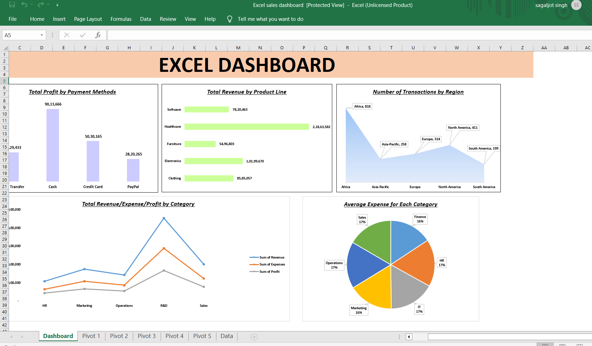

# Excel Sales Dashboard

## Project Overview

This project presents an interactive Sales Dashboard developed using Microsoft Excel. It focuses on analyzing sales performance, revenue, expenses, profitability, payment methods, product lines, and regional transactions.

The workbook uses Pivot Tables, Pivot Charts, and dashboard visualizations to summarize sales data and support business analysis.

## Tools & Technologies

- Microsoft Excel
- Pivot Tables
- Pivot Charts
- Excel Dashboard
- Data Analysis and Visualization

## Dataset

The workbook contains 1,999 sales transaction records and includes the following fields:

- Transaction ID
- Transaction Date
- Revenue
- Expenses
- Profit
- Category
- Region
- Department
- Product Line
- Customer Segment
- Payment Method
- Discount

## Dashboard Analysis

The dashboard includes five visualizations:

1. **Total Profit by Payment Methods** – Compares profitability across payment methods.
2. **Total Revenue by Product Line** – Analyzes revenue generated by different product lines.
3. **Revenue, Expenses and Profit by Category** – Compares financial performance across categories.
4. **Number of Transactions by Region** – Shows transaction distribution across geographical regions.
5. **Average Expense by Category** – Compares average expenses across categories.

## Workbook Structure

| Worksheet | Description                              |
| --------- | ---------------------------------------- |
| Dashboard | Main dashboard with visualizations       |
| Pivot 1   | Profit by payment method                 |
| Pivot 2   | Revenue by product line                  |
| Pivot 3   | Revenue, expenses and profit by category |
| Pivot 4   | Transactions by region                   |
| Pivot 5   | Average expenses by category             |
| Data      | Source transaction dataset               |

## Dashboard Preview

## Key Skills Demonstrated

- Data analysis using Excel
- Pivot Table creation and analysis
- Dashboard development
- Data visualization
- Business performance analysis
- Financial and sales reporting

## How to Use

1. Download the Excel workbook.
2. Open it using Microsoft Excel.
3. Navigate to the Dashboard worksheet.
4. Explore the dashboard visualizations and supporting Pivot Tables.

## Project File

`Excel_Sales_Worksheet.xlsx`

---

**Project Category:** Data Analytics | Microsoft Excel
